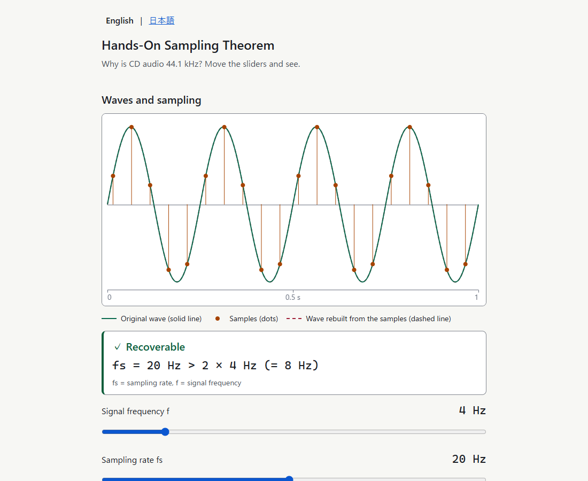
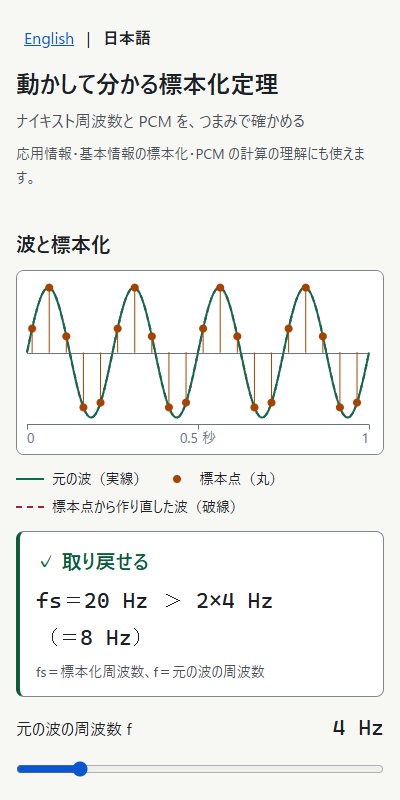

# Hands-On Sampling Theorem

Nyquist and PCM, interactively.

A single static page. Move the knobs to see sampling, aliasing and the Nyquist limit, calculate the data size of PCM audio, and test yourself with four original practice questions. English (`/`) and Japanese (`/ja/`).

Live page: https://r38k51.github.io/hands-on-sampling-theorem/





## Run locally

No dependencies. Node 22 or later is needed only for the build and the tests.

```sh
npm run build        # write index.html, ja/index.html and sitemap.xml
npm test             # run the unit tests (node --test "test/*.test.js")
python -m http.server 8000
```

Then open `http://localhost:8000/` (English) or `http://localhost:8000/ja/` (Japanese). Opening the files directly (`file://`) is not supported.

## License

No license has been chosen yet. If you would like to use this code, please open an Issue.

## 日本語

動かして分かる標本化定理。つまみを動かして標本化定理と折り返し（エイリアス）を目で確かめ、PCM のビット/秒とバイト数を計算し、自作の確認問題で試せる1ページです。英語版（`/`）と日本語版（`/ja/`）があります。

公開ページ：https://r38k51.github.io/hands-on-sampling-theorem/

動かし方は上の「Run locally」と同じです（`npm run build`、`npm test`、`python -m http.server 8000`）。

ライセンスはまだ決めていません。使いたい場合は Issue でお知らせください。
